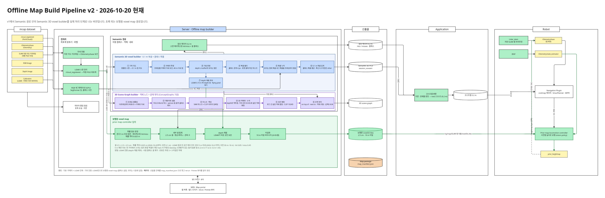

# offline_semantic_mapping

로봇 `.mcap` 녹화에서 **오프라인 맵 패키지**를 만든다. 패키지에는 semantic 복셀, 0.2 m 확률 점유·코스트맵, 3D scene graph, 보행용 3D 맵(locomotion map)이 들어가고, `map_manifest.json` 하나로 묶인다.



*파이프라인 구조도 (Miro "Offline Map Build Pipeline v2", 원본 PDF [docs/SystemPipeline.pdf](docs/SystemPipeline.pdf)). 아래 `scripts/` 디렉터리는 이 그림의 블록과 1:1 로 대응한다.*

## 빠른 시작

```bash
# 서버 컨테이너 offline_3d_semantic_map 안에서
cd sessions
python ../scripts/build_map_package.py session_<이름>.yaml                # 전체 (이미 있는 산출물은 건너뜀)
python ../scripts/build_map_package.py session_<이름>.yaml --steps F,G,H  # 일부 단계만
python ../scripts/build_map_package.py session_<이름>.yaml --force F      # 그 단계를 지우고 다시
python ../scripts/build_map_package.py session_<이름>.yaml --dry-run      # 실행할 명령만 출력
```

- 결과는 `output/<이름>/{graph,dataset,sem,voxel,compiled,logs}` 에 생긴다. 패키지 파일은 `compiled/map_manifest.json`.
- 패키지 로드와 보기: `python scripts/package/load_map.py output/<이름>/compiled/map_manifest.json --rrd out.rrd`
- 예전 명령 `cd sessions && python build_map_package.py ...` 도 그대로 동작한다. `sessions/build_map_package.py` 가 `scripts/` 로 넘겨준다.
- 노트북에서 빌드하는 법(기하 전용 · semantic 맵까지, Docker): [docker/laptop/README.md](docker/laptop/README.md)

### 세션 yaml 의 빌드 종류

| 종류 | 옵션 | 단계 | 산출물 |
|---|---|---|---|
| 전체 | (기본) | 모든 단계 | 아래 전부 |
| semantic 맵까지 | `options.objects: false` | D·E 생략 | 3D scene graph 를 뺀 나머지 |
| 기하 전용 | `options.geometry_only: true` | Q·P·S·F·G·H | 보행용 맵(클래스 없음) + Potree |

새 세션은 기존 세션 yaml(기하 전용은 `sessions/session_TEMPLATE_geometry_only.yaml`)을 복사해 `mcap_dir`, `logs`, `root` 를 고쳐서 만든다.

## 디렉터리 구조

```
offline_semantic_mapping/
├── scripts/              ← 소스 코드 전부
│   ├── build_map_package.py   빌드 진입점 (세션 yaml → 맵 패키지)
│   ├── pipeline/              빌드 단계 구현 (블록별)
│   ├── preprocess/            전처리: 자세 · 스캔 · RGB · 세그멘테이션
│   ├── semantic/              Semantic 경로
│   │   ├── voxel/                 Semantic 3D voxel builder
│   │   ├── scene_graph/           3D Scene Graph builder
│   │   └── occupancy/             0.2 m 점유 레이어
│   ├── locomotion_map/        보행용 3D 맵 (voxel3d 타일)
│   ├── package/               패키지 · 뷰어 · 영상
│   ├── apps/                  패키지를 쓰는 응용 (코스트맵, 내비 내보내기, 위치추정)
│   ├── common/                공용 (클래스 사전 · 세그 모델 레지스트리)
│   ├── recording/             녹화 커버리지 모니터 (녹화 중 · 후 '어디가 비었나')
│   └── dev/                   실험 · 평가 · 비교 도구 (빌드에는 안 쓰임)
├── sessions/             세션 yaml (빌드 설정)
├── tools/                맵 포털 웹 서버 · systemd 서비스 · Potree 뷰어/변환기
├── docker/laptop/        노트북용 빌드 이미지 (기하 전용 + semantic 맵)
├── classdicts/           클래스 사전 JSON (세그 모델 라벨 → 맵 클래스)
├── docs/                 문서 (HANDOFF 이력, 데이터 흐름, voxel3d 형식, 녹화 체크리스트)
├── gt/                   GT 데이터와 정량 평가 실험
├── third_party/bonxai/   Bonxai (확률 점유 비교용 C++ 라이브러리)
├── models/               로컬 미세조정 체크포인트 (git 제외)
├── output/               빌드 결과 (git 제외)
└── requirements-*.txt    컨테이너 밖 설치용 (geometry: 기하 전용, semantic: + SegFormer, recording: 커버리지 모니터만)
```

### `scripts/pipeline/` — 빌드 단계

`build_map_package.py` 의 `Build` 클래스는 아래 믹스인을 조립만 한다. 각 단계는 블록 디렉터리의 스크립트를 subprocess 로 부른다.

| 파일 | 단계 | 내용 |
|---|---|---|
| `env.py` | | `CODE`(= scripts/), `REPO`(= 저장소 루트), 파이썬 경로, ConceptGraphs · 모델 캐시 위치 |
| `core.py` | | 세션 yaml 해석, 출력 폴더, 실행 · 로그 · 건너뛰기 규칙, 단계 순서(`go`) |
| `preprocess_steps.py` | Q P A S R B | 품질 점검 · 자세 그래프 · RGB-D 데이터셋 · LiDAR 스캔 · RGB 추출 · 세그멘테이션 |
| `semantic_steps.py` | C D E F | semantic 복셀 · ConceptGraphs 객체 · scene graph 병합/엣지 · 0.2 m 점유 |
| `locomotion_map_steps.py` | F3d | 보행용 3D 맵 (`options.voxel3d`) |
| `package_steps.py` | G H V | `map_manifest.json` · rerun/Potree 뷰어 · 영상 |
| `app_steps.py` | (G 안) | 점유 레이어 → 코스트맵 등록 |

### `scripts/preprocess/` — 전처리

| 파일 | 내용 |
|---|---|
| `mcap_quality.py` | 토픽별 주기 · 유실 · 지연 점검 → `compiled/data_quality.{json,rrd}` (Q) |
| `geometry/robot_graph.py` | 로봇 SLAM 저장 지도 키프레임 + `/Odometry/base` 보간 → `graph/` (P) |
| `geometry/build_graph.py` | (옛 트랙 1) deskew 키프레임 + 루프 클로저 + GTSAM PGO (P) |
| `geometry/` 나머지 | mcap/PointCloud2 디코더(`raisin_msgs`, `pc2_reader`), 외부 파라미터, deskew, `pose_provider` (그래프 자세 조회) |
| `mcap_to_cg.py` | mcap → ConceptGraphs 형식 RGB-D 데이터셋 `dataset/<log>/` (A) |
| `export_registered_scans.py` | `/cloud_registered` → 최종 PGO 좌표계 스캔 `lidar_scans/` (S) |
| `export_lidar_scans.py` | (옛 트랙 1) raw LiDAR deskew 스캔 (S) |
| `extract_rgb_session.py` | LiDAR 시각에 맞춘 RGB → `sem/rgb/` (R) |
| `precompute_semantic.py` | 세그멘테이션 (SegFormer / Mask2Former / EoMT, 클래스 사전) → `sem/sem/` (B, GPU, `options.seg_batch`) |

### `scripts/semantic/` — Semantic 경로

| 파일 | 내용 |
|---|---|
| `voxel/scans_to_pcd.py` | 정렬된 스캔 → 기하 점 지도 (C ①) |
| `voxel/label_map_points.py` | 카메라 투영 · depth 가림 판정 · 픽셀 필터 · 세그 확률 누적 → `session_voxsem.npz`, `robot_map_semantic.pcd` (C ②–⑦) |
| `voxel/build_voxel_sem_map.py`, `merge_voxels.py` | (옛 트랙 1) 로그별 semantic 복셀과 세션 병합 |
| `scene_graph/map_compiler.py` | 로그 간 객체 병합 · 휴리스틱 관계 엣지 · 객체-지형 엣지 → `session_objects.json` (E) |
| `scene_graph/vlm_edges.py` | (선택) VLM 으로 관계 엣지 판정 |
| `scene_graph/voxel_rerun_v2.py`, `edges_session_rerun.py` | scene graph rerun 시각화 |
| `scene_graph/cg_query.py` | 객체 CLIP 특징으로 텍스트 질의 |
| `occupancy/build_occupancy.py` | 스캔 레이캐스팅 hit/miss + 셀 클래스 → `session_occupancy.npz` (0.2 m, F) |

ConceptGraphs 객체 검출(D) 자체는 외부 설치본(`/data2/cg/concept-graphs`)을 부른다.

### `scripts/locomotion_map/` — 보행용 3D 맵

| 파일 | 내용 |
|---|---|
| `build_voxel3d.py` | 확률 점유(센서 5 m 이내, 확률 격자 0.025 m) + 2.5 cm 셀 통계 + depth 채움 + 10 m 타일 → `session_voxel3d.npz`, `session_voxel3d_tiles/` (F3d) |
| `bonxai/` | Bonxai ProbabilisticMap 점유 판정 (`--occupancy bonxai`, `build.sh` 로 빌드) |
| `voxel3d_view.py`, `voxel3d_slice_view.py`, `voxel3d_build_replay.py` | rerun 뷰 · 단면 · 빌드 과정 재생 |
| `voxel3d_eval.py` | hold-out 스캔으로 윗면 오차 · 미응답 평가 |
| `voxel3d_drop_fill.py`, `voxel3d_tiles_filter.py` | 채움 셀(평탄 · depth)을 뺀 변형 · 타일 사본 |
| `build_voxel3d_from_pcd.py` | 완성된 PCD 로 voxel3d 타일 만들기 |

타일 형식은 [docs/VOXEL3D_PRIOR.md](docs/VOXEL3D_PRIOR.md) 에 있다.

### `scripts/package/` — 패키지 · 뷰어

| 파일 | 내용 |
|---|---|
| `load_map.py` | `map_manifest.json` 로더 (`MapPackage`) + rerun/BEV 출력 (H) |
| `export_pcd.py` | 패키지 → `.pcd` (semantic 복셀 · 점유 · voxel3d 등 source 선택) |
| `potree_export.py` | Potree 웹 뷰어 `compiled/potree/` (H) |
| `cube_mesh.py` | rerun 용 속이 찬 복셀 큐브 메시 |
| `make_rgb_video.py`, `make_pipeline_video.py` | RGB 배속 영상 · RGB/검출/세그 3분할 영상 (V) |

### `scripts/apps/` — 패키지를 쓰는 응용

| 파일 | 내용 |
|---|---|
| `costmap_from_occupancy.py` | 점유 레이어 → nav2 코스트맵 0.2 m |
| `export_nav_semantic.py`, `crosswalk_extend.py` | 로봇 내비용 semantic 레이어 내보내기 · 횡단보도 확장 |
| `localize.py`, `localize_server.py` | 맵 위 초기 위치추정 (CLI · 대화형 서버, `tools/start_localize_server.sh`) |
| `verify_requests.py`, `robot_usecase_demo.py`, `policy_adherence.py` | 패키지만으로 로봇 요청 검증 · semantic 내비 유스케이스 데모 · 산책로 준수 정책 비교 |

### `scripts/recording/` — 녹화 커버리지 모니터

`coverage_monitor.py` 는 mcap 을 읽으면서 맵 빌더와 같은 기준으로 **어디가 매핑됐고 어디가 비었는지** 를 rerun 으로 보여준다. 녹화 중(`--live`, 레코더가 쓰는 파일을 뒤따라 읽음)에도, 녹화가 끝난 뒤에도 쓸 수 있다.

- 위쪽 3D 두 화면은 같은 LiDAR 맵 위에 색만 다르게 칠한다.
  - LiDAR 커버리지: 센서 5 m 이내에서 3번 이상 본 곳 초록, 그보다 적게 본 곳 노랑.
  - 카메라 커버리지: semantic 라벨이 붙을 곳 파랑, 안 붙을 곳 보라.
  - 둘 다 카메라 프러스텀 · RGB 영상 · 이동 경로를 같이 보여준다.
- 아래쪽에는 위에서 본 2D 지도 2개(현재 카메라 화각 부채꼴 포함), 상태 그래프, 경고를 둔다.
  - 상태: SLAM 지연, 레코더 유실, IO 압력, CPU.
  - 경고: 토픽 끊김, 저장 맵 위치추정 모드 전환.
- 판정 기준은 빌드 결과와 맞춰 검증했다 (`dev/coverage_vs_build.py`). LiDAR 는 칸 단위 99.8–100 %, 카메라는 86–93 % 일치.
- 녹화 장비 부담은 녹화 시간 대비 CPU 코어 하나의 약 10 %. nice · ionice 로 돌고, 레코더 유실이나 큐가 늘면 depth 처리를 멈춘다.

```bash
python3 -m venv ~/.venvs/coverage && ~/.venvs/coverage/bin/pip install -r requirements-recording.txt   # 처음 한 번
~/.venvs/coverage/bin/python scripts/recording/coverage_monitor.py <세션 폴더>               # 녹화 끝난 데이터 (rerun 창)
~/.venvs/coverage/bin/python scripts/recording/coverage_monitor.py <녹화 중 세션 폴더> --live  # 녹화 중 (Ctrl+C 로 끝)
#   --sim : 시뮬 녹화 · --mask-bottom 60 : 로봇 몸체가 화면 아래에 보이는 세션
#   --view connect : 떠 있는 `rerun --serve` 로 보내 브라우저(http://<PC>:9091/?url=ws://<PC>:9877)로 보기
#   --view save    : <out>/coverage.rrd 로 저장
```

인자 없이 실행하면 레코더 제어 소켓(127.0.0.1:8089)에 물어 **녹화 중이면 그 세션을 `--live` 로**, 아니면 `$REC_OUTPUT_DIR`(기본 `~/logger_data`) 의 가장 최근 세션을 재생한다.
녹화 PC 의 GNOME 독에는 "매핑 커버리지 모니터" 아이콘(`scripts/recording/coverage_monitor_launch.sh`, 센서 수집 아이콘과 같은 방식)이 있다: 누르면 녹화 시작을 기다렸다가 자동으로 모니터를 띄우고, 다시 누르면 결과를 저장하고 끝난다. 길게 누르면 `마지막 세션 재생` · `결과 폴더 열기`. 추가 옵션은 `COVERAGE_MONITOR_ARGS="--mask-bottom 60"` 처럼 환경변수로.

```bash
~/.venvs/coverage/bin/python scripts/recording/coverage_monitor.py            # 인자 없이: 녹화 중이면 --live, 아니면 최근 세션 재생
scripts/recording/coverage_monitor_launch.sh [stop|replay|results]           # 독 아이콘이 부르는 스크립트
```

`<세션 폴더>` 는 `log_000.mcap …` 과 `config_snapshot/raisin_root/calibration`(또는 `raisin_config/calibration`)이 있는 폴더다. 결과 `coverage_summary.json` · `coverage_bev.png` · `coverage_camera.png` · `coverage_grid.npz` 는 `output/_coverage/<세션 이름>/` 에 생긴다.

### `scripts/dev/` — 실험 · 평가 (빌드에는 안 쓰임)

빌드 결과 비교(`compare_build_outputs.py`: 리팩터링 회귀 검증), 맵 · 코스트맵 · 기하 비교, 외부 파라미터 탐색, OctoMap 비교, deskew · 그래프 · 위치추정 벤치마크(`geometry/`) 등.

## 더 읽을 것

- [docs/HANDOFF.md](docs/HANDOFF.md) — 전체 이력 · 결정 · 함정 (날짜순)
- [docs/DATA_FLOW.md](docs/DATA_FLOW.md) — 단계별 데이터 흐름
- [docs/VOXEL3D_PRIOR.md](docs/VOXEL3D_PRIOR.md) — 보행용 맵 형식 · 로봇 적재
- [docs/RECORDING_CHECKLIST.md](docs/RECORDING_CHECKLIST.md) — 녹화 체크리스트
- [scripts/preprocess/geometry/GRAPH_FORMAT.md](scripts/preprocess/geometry/GRAPH_FORMAT.md) — `graph/` 형식
- 외부 설치물 (컨테이너 안, 데이터 디스크): ConceptGraphs 패치판 `/data2/cg/concept-graphs`, 모델 캐시 `/data2/cg/hf_cache`
